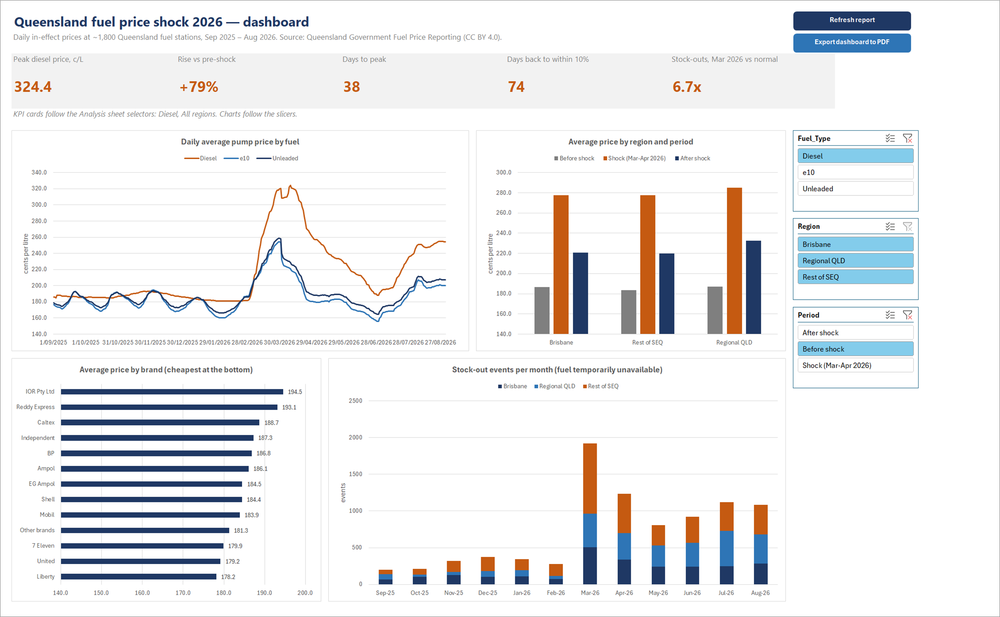
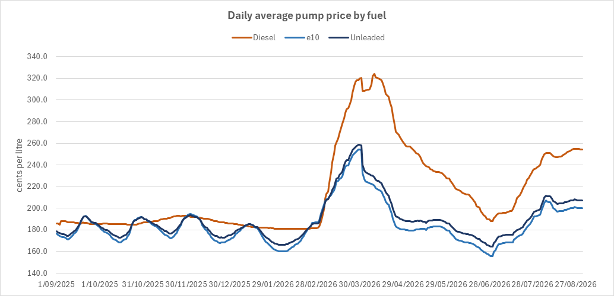
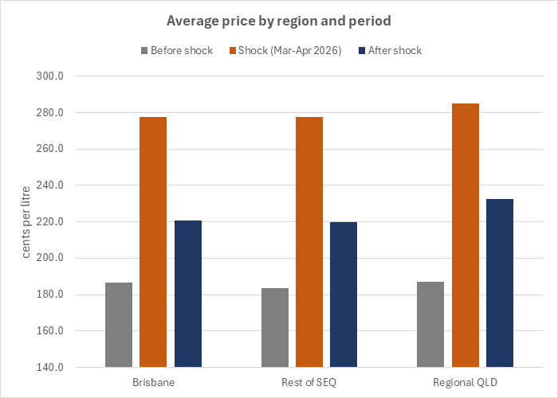
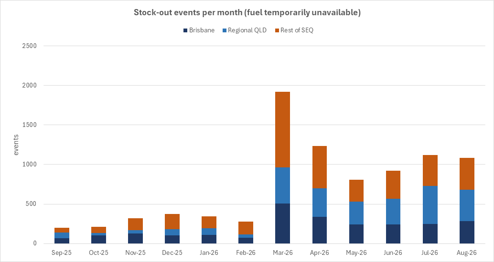
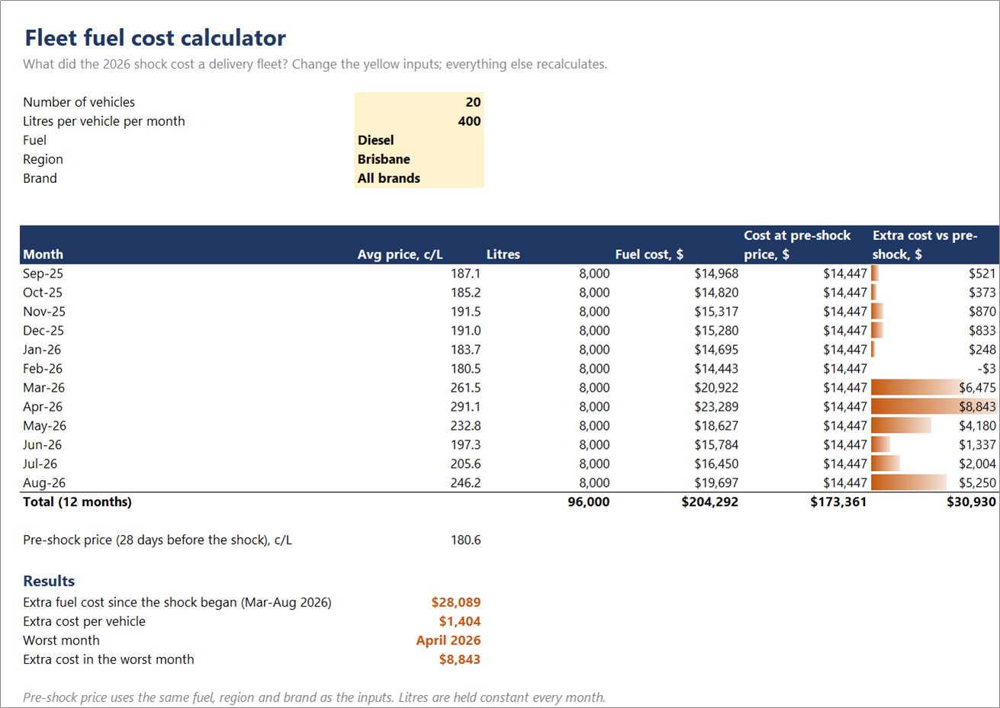
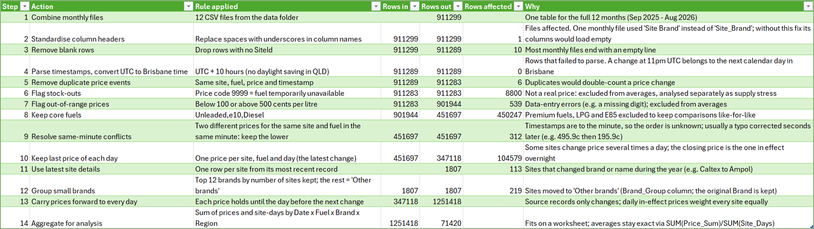
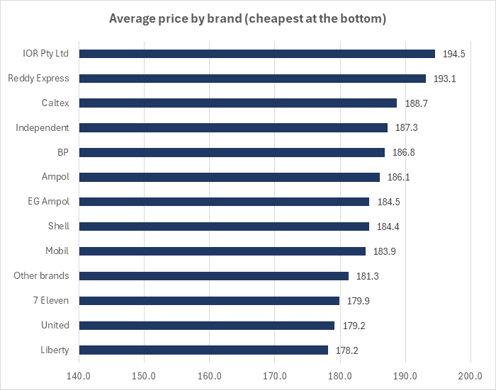

# Queensland Fuel Price Shock 2026

**How much did the March–April 2026 Middle East supply shock raise fuel costs in Queensland, who paid the most, and what can a business running vehicles do about it?**

An Excel-first analysis of **911,299 official price records** from every fuel station in Queensland (September 2025 – August 2026). All data preparation runs in **Power Query** (a refreshable, fully logged 14-step cleaning pipeline). The analysis is done with **live Excel formulas** (`XLOOKUP`, `LET`, `FILTER`, `SORTBY`, `SUMIFS`, `INDEX-MATCH`, `LAMBDA`). The results feed a **PivotTable dashboard with slicers** and a **what-if fleet cost calculator**, and **VBA** refreshes the report and exports it to PDF in one click.

---

## The Business Problem

In early March 2026, strikes on Iran disrupted shipping through the Strait of Hormuz. Australian pump prices jumped within days, the RACQ referred retailers to the ACCC, and panic buying left pumps dry across the state. Any business that runs vehicles — delivery fleets, tradies, logistics, field services — took the hit directly. Most could only describe it as "fuel went up a lot".

**The business question:** using the Queensland Government's mandatory fuel price reporting data, how big was the shock and how quickly did it fade? Did regional Queensland pay more than Brisbane, and which brands were cheapest? Is there a smarter time to fill up, did the shock cause real shortages, and what did all of this cost a typical fleet?

## My Approach

1. **Built a refreshable, logged data pipeline in Power Query.** It combines 12 monthly CSV files, standardises inconsistent headers, converts UTC timestamps to Brisbane time and removes duplicates. It flags stock-outs and impossible prices and resolves conflicting same-minute reports. Every step is named in Power Query, counted in a `Cleaning_Log` sheet that recalculates on every refresh, and exported as readable M code in [`power-query/`](power-query/).
2. **Fixed a real methodological trap in the source data.** The government feed records only price *changes*, not daily prices. Averaging the raw rows would over-weight stations that change price often. Each price is instead carried forward until that station's next change, which turns 347,118 daily closing prices into **1.25 million station-days**, so every station counts equally every day.
3. **Answered five business questions with live formulas** on the `Analysis` sheet. Two dropdowns (fuel and region) re-run every answer. Brand rankings use dynamic arrays (`FILTER`, `SORTBY`, `HSTACK`), and price-cycle peaks are detected with `MAP` + `LAMBDA` over a 7-day window.
4. **Turned it into tools a manager would use.** A dashboard of four PivotCharts driven by slicers, plus a `Fleet_Calculator` where you enter fleet size, litres, fuel, region and brand to see exactly what the shock cost.
5. **Validated every number independently.** [`validate_excel_results.py`](validate_excel_results.py) re-implements all the cleaning rules in Python and checks 15 counts and averages against the workbook, and all 15 match. The check caught three real issues along the way: a timezone shift that silently cut one day from the period, blank trailing rows, and 312 same-minute price conflicts that the two tools resolved differently until a rule was set.

## Key Findings

| Question | Finding |
|---|---|
| Size of the shock | Statewide diesel rose from **181.2 c/L** (28 days before the shock) to a peak of **324.4 c/L on 9 April 2026, up 79%**. Unleaded in Brisbane peaked at 257.9 c/L on 30 March (+44%) |
| Rockets and feathers | Diesel took **38 days to reach its peak but 74 days** to come back within 10% of its pre-shock price. At the end of August it was still **40% above** the pre-shock level, and rising again |
| Regional Queensland | Before the shock, regional diesel cost only 0.7 c/L more than Brisbane. The gap grew to **7.6 c/L during the shock and 11.9 c/L after it**: regional prices rose further and fell more slowly |
| Brands | Before the shock, the cheapest diesel brand (Pearl Energy, 175.3 c/L) was **19.2 c/L below the dearest** (IOR, 194.5 c/L). In Brisbane, Liberty and United were the cheapest unleaded brands, 9–11 c/L below the market average |
| When to fill up | **The day of the week barely matters.** Brisbane unleaded varies by less than 1 c/L across weekdays. **The price cycle matters a lot:** it swings about **36 c/L from low to peak roughly every 5–6 weeks**, which is about **$22 on a 60 L tank** |
| Shortages | Stock-out reports (pumps temporarily empty) jumped to **1,917 in March 2026, 6.7 times a normal month**. They were still around **3.8 times normal in August**, so supply stress outlasted the price spike |
| Cost to a fleet | A Brisbane fleet of **20 diesel vans** using 400 L a month each paid **$28,089 extra (Mar–Aug 2026)**, about $1,404 per vehicle. The worst month was April, at **$8,843** over budget |

| Regional gap widened during and after the shock | Stock-outs: 6.7x normal in March 2026 |
|---|---|
|  |  |

## Why This Matters

The headline everyone remembers is "fuel hit record prices". The data adds three things a budget owner can act on. First, **the recovery was far slower than the spike**: a business that budgeted for a short spike was still over budget six months later. Second, **regional Queensland carried a bigger and longer-lasting burden**, which matters for regional operators and for policy. Third, **a lot of what people pay is avoidable**: brand choice is worth up to 19 c/L and timing the price cycle up to 36 c/L, while the popular "fill up on a Tuesday" advice is worth less than 1 c/L.

## Business Recommendations

1. **Budget fuel for the slow way down, not the fast way up.** Plan for prices staying elevated for months after a supply shock. In this event diesel took twice as long to recover as it did to spike.
2. **Choose a fuel card by price, not habit.** Pre-shock price gaps between brands (up to 19 c/L for diesel) are worth more than most fuel-card discounts. The `Analysis` sheet ranks brands for any fuel and region.
3. **For unleaded fleets in South East Queensland, fill at the bottom of the price cycle.** Ignore the weekday. Tracking the cycle (or using the state's price app) is worth around 36 c/L at the extremes.
4. **Treat regional operations as a separate risk.** Regional sites faced both higher prices and more stock-outs. Keeping on-site fuel buffers or contracted supply there is worth reviewing.
5. **Keep the report alive.** The workbook refreshes from new monthly files with one click, so the analysis can track the next shock as it happens.

## Interactive Workbook

[`qld_fuel_price_analysis.xlsm`](qld_fuel_price_analysis.xlsm) (Excel 365, macros enabled):

| Sheet | What it does |
|---|---|
| `Dashboard` | KPI cards, four PivotCharts, slicers for fuel, region and period, and **Refresh report** / **Export to PDF** buttons (VBA) |
| `Analysis` | The five business questions, answered by live formulas; change fuel and region in the yellow cells |
| `Fleet_Calculator` | What-if tool: fleet size, litres, fuel, region and brand → monthly cost and extra cost vs pre-shock |
| `Cleaning_Log` | Rows in / rows out for each of the 14 cleaning steps, recalculated by Power Query on refresh |
| `Settings` | Every threshold the queries use (data folder, valid price range, region distances, shock dates), editable without touching code |
| `Data_*` | Power Query outputs: daily price fact table, station dimension, stock-out events |

| Fleet cost calculator | Every cleaning step, counted |
|---|---|
|  |  |

Full methodology, data-quality decisions and every result table: **[executive_summary.md](executive_summary.md)**.

## Limitations

- Prices are **daily closing prices carried forward**, an exact reconstruction of what each station displayed overnight. A station that ran a short intraday discount and reversed it the same day is counted at its closing price.
- **Regions are distance bands** from the Brisbane CBD (Brisbane ≤ 25 km, Rest of SEQ ≤ 150 km, Regional QLD beyond), not official ABS boundaries. The thresholds are editable in `Settings`.
- Averages are **station-weighted, not volume-weighted**: the data has no sales volumes, so a quiet country station counts the same as a busy highway site.
- The fleet calculator assumes constant monthly litres and buying at the average price for the chosen region and brand.
- **Refresh time:** a full refresh reprocesses all 911k rows and takes about 15–30 minutes on a laptop. This is fine for a monthly report. Several years of history would belong in Power BI or a SQL database instead.

## Tools & Skills

`Excel 365` · `Power Query (M)`: folder combine, header standardisation, type/timezone conversion, de-duplication, grouping, fill-forward modelling, performance tuning (`Table.Buffer`, `List.Buffer`, narrow tables) · Dynamic-array formulas: `XLOOKUP`, `LET`, `FILTER`, `SORTBY`, `UNIQUE`, `HSTACK`, `VSTACK`, `MAP`/`LAMBDA`, `SUMIFS` with wildcard criteria, `INDEX-MATCH` · `PivotTables` with calculated fields, `PivotCharts`, slicers · Data validation and conditional formatting · `VBA` (refresh automation, PDF export) · `Python` (pandas) for independent validation only · data-quality investigation and a documented cleaning log.

## Reproduction

The raw data (12 monthly CSV files, about 120 MB) is not committed. Download it from the Queensland Government Open Data Portal: [Fuel price reporting 2025](https://www.data.qld.gov.au/dataset/fuel-price-reporting-2025) (September–December 2025) and [Fuel price reporting 2026](https://www.data.qld.gov.au/dataset/fuel-price-reporting-2026) (January–August 2026). Licence: CC BY 4.0.

1. Put the 12 CSV files in one folder.
2. Open `qld_fuel_price_analysis.xlsm`, enable macros, and enter that folder path in `Settings` → `DataFolder` (it ships set to `C:\data\qld-fuel-prices`).
3. Click **Refresh report** on the `Dashboard` (or Data → Refresh All).
4. Optional: `python validate_excel_results.py <data folder>` re-checks the workbook's numbers independently (requires pandas, numpy, openpyxl).

---

*Portfolio project — Master of Business Analytics, Kaplan Business School.*
